# FundiShorp – Agile Project Portfolio

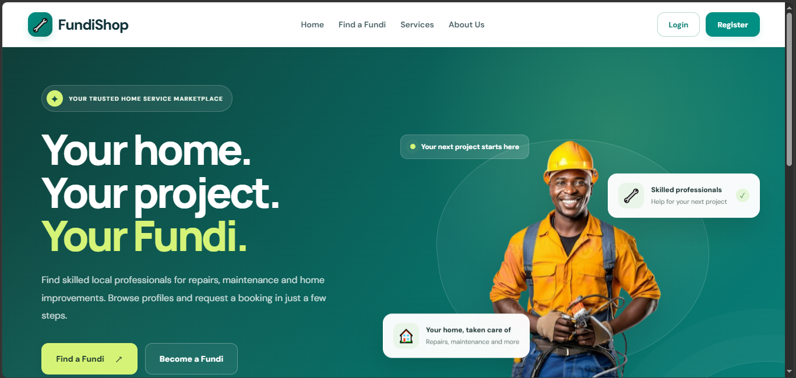

## Project Overview

FundiShorp is a proposed online platform designed to connect homeowners with fundis (skilled tradespeople) who provide home improvement, maintenance, repair and construction services. The platform also aims to allow fundis to advertise their services and building materials to potential customers.

This portfolio documents my work on the FundiShorp project using Agile project management principles. It presents the project charter, user stories, product backlog, sprint planning and supporting evidence of the work completed during the project.

The project is being developed incrementally, with tasks and requirements organised to support planning, implementation, testing and continuous improvement.

## 1. Agile Project Charter

### 1.1 Project Purpose

The purpose of FundiShorp is to make it easier for homeowners to find suitable tradespeople and access services or materials needed for home improvement projects. The platform is intended to provide a central place where customers can explore available fundis and where service providers can present their offerings.

### 1.2 Problem Statement

Finding reliable tradespeople and comparing their services can be difficult when information is spread across different sources. Customers may also struggle to identify service providers who have been verified.

FundiShorp aims to address this problem by providing an online platform where users can find fundis, view available services and materials, and access relevant information before making decisions.

### 1.3 Project Objectives

The main objectives of the project are to:

- Develop a user-friendly frontend for the platform.
- Create a backend to process application requests and manage data.
- Design and connect a MySQL database.
- Support homeowner and fundi registration.
- Apply role-based access according to user roles.
- Allow fundis to manage their service or product listings.
- Provide functionality for searching and viewing available fundis.
- Organise project requirements and development tasks using Agile methods.
- Document project progress and provide supporting evidence.

### 1.4 Project Scope

**Included in the project:**

- User registration and login.
- Fundi registration and profile management.
- Role-based access control.
- Fundi verification-related functionality.
- Storefront and product listing management.
- Viewing product and service information.
- Searching for fundis.
- Database and backend development.
- Agile planning and project documentation.

**Outside the initial scope:**

- A fully operational payment gateway.
- A production-scale mobile application.
- Advanced analytics and automated recommendations.

These items may be considered for future development if time and resources allow.

### 1.5 Technologies and Tools

| Technology or tool | Purpose |
|---|---|
| React | Developing the user interface |
| Java Spring Boot | Developing backend services and API endpoints |
| MySQL | Storing and managing application data |
| Git and GitHub | Version control and project hosting |
| Trello | Managing the product backlog and sprint tasks |
| GitHub Pages | Publishing the project portfolio |

### 1.6 Agile Approach

I am using an Agile approach to organise the project into manageable tasks and prioritise the development of important features. User stories describe the needs of different users, while tasks break the work into smaller activities.

Trello is used to organise the backlog and track project activities. The project can be reviewed and adjusted as development progresses, allowing requirements and priorities to be refined when necessary.

### 1.7 Stakeholders

The main stakeholders are:

- **Homeowners:** People who need home improvement services or building materials.
- **Fundis:** Tradespeople who want to advertise their skills, services or products.
- **Administrator:** A user responsible for managing platform activities and verification-related processes.
- **Developer:** The student responsible for planning, developing, testing and documenting the project.

### 1.8 Expected Outcomes

The expected outcome is a functional web application prototype that demonstrates the main requirements of the FundiShorp platform. The project portfolio also provides evidence of Agile planning, technical development and project documentation.

---

## 2. User Stories and Tasks

The following user stories describe the main requirements identified for FundiShorp. Each story represents a feature or capability from the perspective of a user or the development team.

The screenshots provide supporting evidence of selected development activities. The presence of a screenshot does not necessarily mean that the feature has been fully tested or completed.

### US01 – Establish the Database Schema

**User story:** As a developer, I want to create a database schema so that application data can be stored in a structured way.

**Tasks:**
- Identify the main entities and their attributes.
- Define primary and foreign keys.
- Establish relationships between database tables.
- Create the schema in MySQL.
- Check the relationships and constraints.

**Acceptance criteria:**
- The required tables are created.
- Primary keys and relationships are defined where required.
- The schema supports the planned application features.

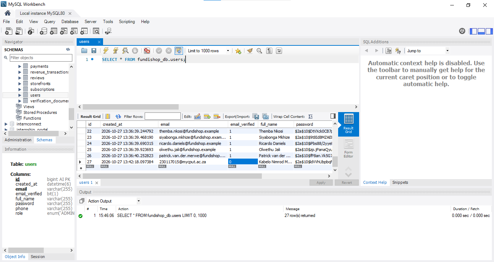

### US02 – Develop the Backend

**User story:** As a developer, I want to develop backend services so that the frontend can communicate with the database through an API.

**Tasks:**
- Set up the Spring Boot project.
- Organise the backend into appropriate layers.
- Create the required models, repositories and services.
- Develop REST API endpoints.
- Configure the database connection.
- Test API requests and responses.

**Acceptance criteria:**
- The backend starts successfully.
- API endpoints process supported requests.
- Database operations work for the implemented features.
- Errors are handled appropriately.

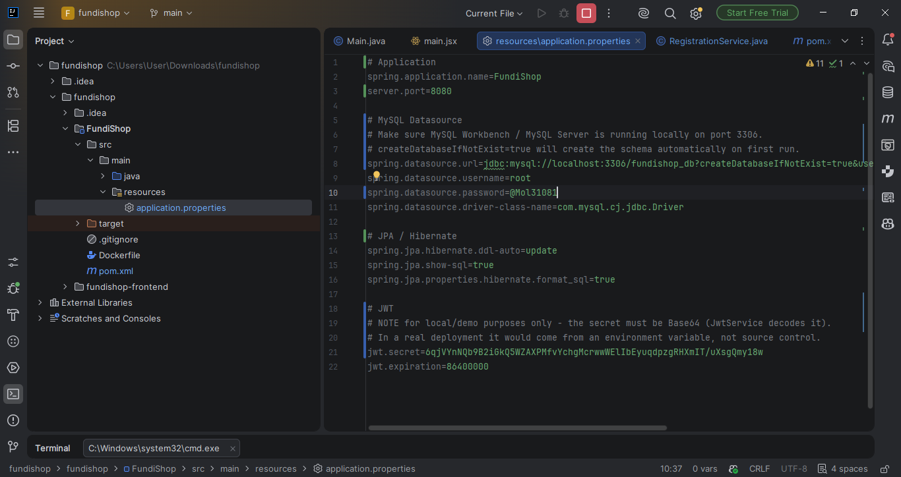

### US03 – Develop the Frontend

**User story:** As a user, I want a clear and accessible interface so that I can navigate the platform and use its features.

**Tasks:**
- Set up the React application.
- Create reusable interface components.
- Develop the main pages and navigation.
- Connect frontend components to available API endpoints.
- Test page layout and navigation.

**Acceptance criteria:**
- The main pages display correctly.
- Users can navigate between available sections.
- Implemented frontend features communicate with the backend where required.

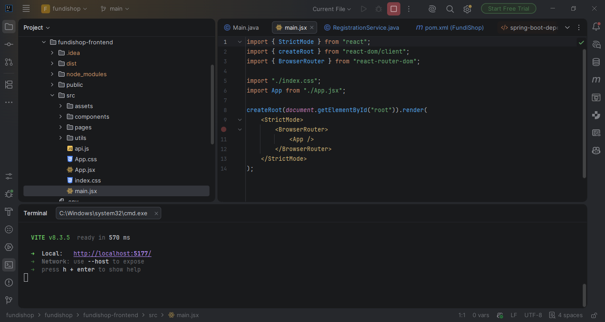

### US04 – Prepare for Deployment

**User story:** As a developer, I want to prepare the application for deployment so that it can be accessed and demonstrated online.

**Tasks:**
- Review application configuration.
- Identify hosting requirements for the frontend and backend.
- Configure environment-specific settings.
- Test the deployment process.
- Document any remaining deployment limitations.

**Acceptance criteria:**
- Deployment requirements are documented.
- The frontend can be prepared for hosting.
- Backend and database hosting requirements are identified.

### US05 – Register and Log In as a Homeowner

**User story:** As a homeowner, I want to register and log in so that I can access the platform using my account.

**Tasks:**
- Create the registration interface.
- Create the login interface.
- Validate submitted information.
- Connect the forms to the relevant backend endpoints.
- Test registration and login scenarios.

**Acceptance criteria:**
- Users can submit registration details.
- Required fields are validated.
- Login requests are processed by the backend.
- Feedback is provided when a request succeeds or fails.

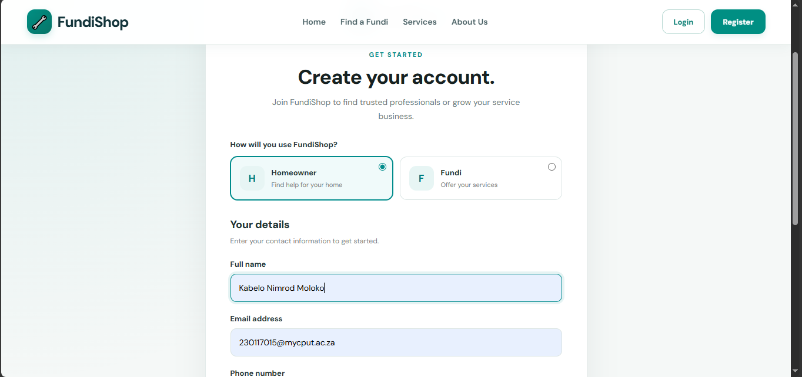

### US06 – Register as a Fundi

**User story:** As a fundi, I want to register my details so that I can offer my services through the platform.

**Tasks:**
- Create the fundi registration form.
- Capture the required profile information.
- Include relevant verification information where required.
- Connect the form to the backend.
- Test form validation and data submission.

**Acceptance criteria:**
- Fundis can submit their registration information.
- Required information is validated.
- Submitted information is handled by the backend.

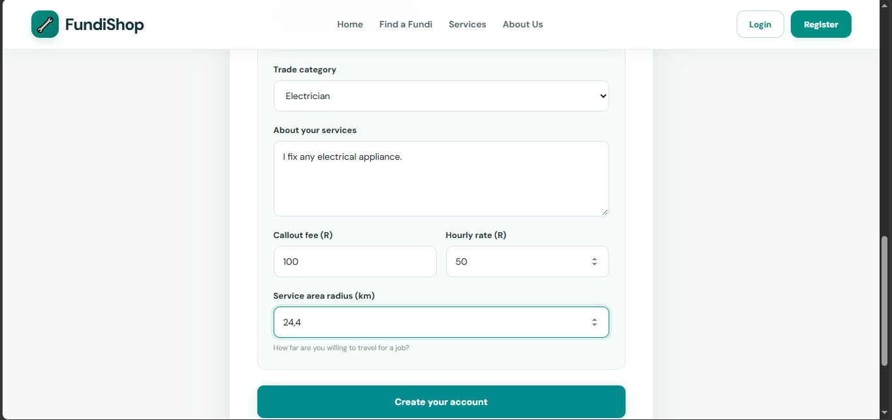

### US07 – Apply Role-Based Access

**User story:** As a platform user, I want access to features appropriate to my role so that different types of users have the correct permissions.

**Tasks:**
- Define the required user roles.
- Associate roles with user accounts.
- Apply access rules to relevant features.
- Test access for different roles.

**Acceptance criteria:**
- User roles are identified.
- Access to protected features is controlled according to the implemented rules.
- Users cannot access restricted functions without the required permissions.

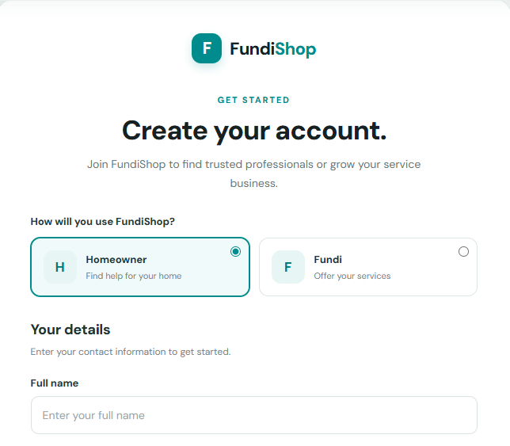

### US08 – Review Fundi Verification Documents

**User story:** As an administrator, I want to review fundi verification information so that I can assess whether a fundi meets the platform's verification requirements.

**Tasks:**
- Identify the required verification information.
- Provide a way to review submitted details.
- Record verification decisions where implemented.
- Test the verification workflow.

**Acceptance criteria:**
- Relevant verification information can be reviewed.
- Verification decisions can be recorded if the workflow is implemented.
- The status is available to the relevant parts of the application.
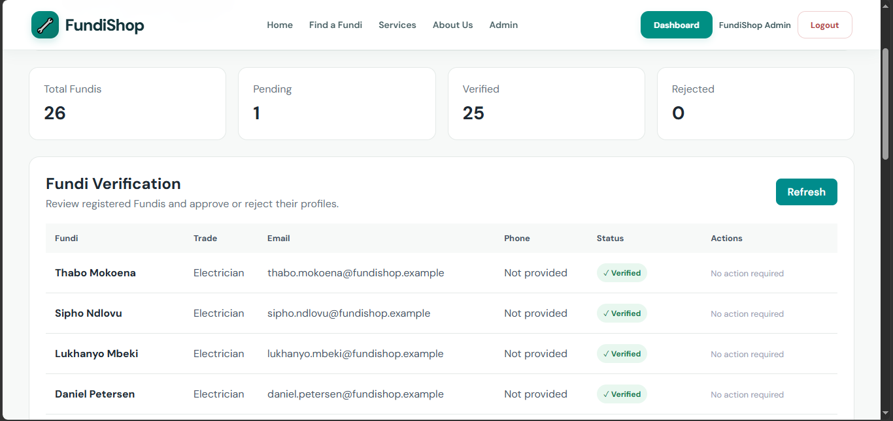

### US09 – Display a Verified Badge

**User story:** As a homeowner, I want to identify verified fundis so that I can make a more informed decision when selecting a service provider.

**Tasks:**
- Define the verification status used by the application.
- Connect the status to the fundi profile.
- Display the badge when the required conditions are met.
- Test verified and unverified profiles.

**Acceptance criteria:**
- Verification status is represented consistently.
- A verified badge is displayed only when the required verification condition is satisfied.

### US10 – Create a Storefront

**User story:** As a fundi, I want to create a storefront so that customers can view information about my services or products.

**Tasks:**
- Design the storefront interface.
- Capture storefront information.
- Connect storefront data to the backend.
- Display the information on the relevant page.

**Acceptance criteria:**
- A fundi can provide storefront information where the feature is implemented.
- Storefront information is displayed appropriately.
- The interface supports the planned service or product listings.

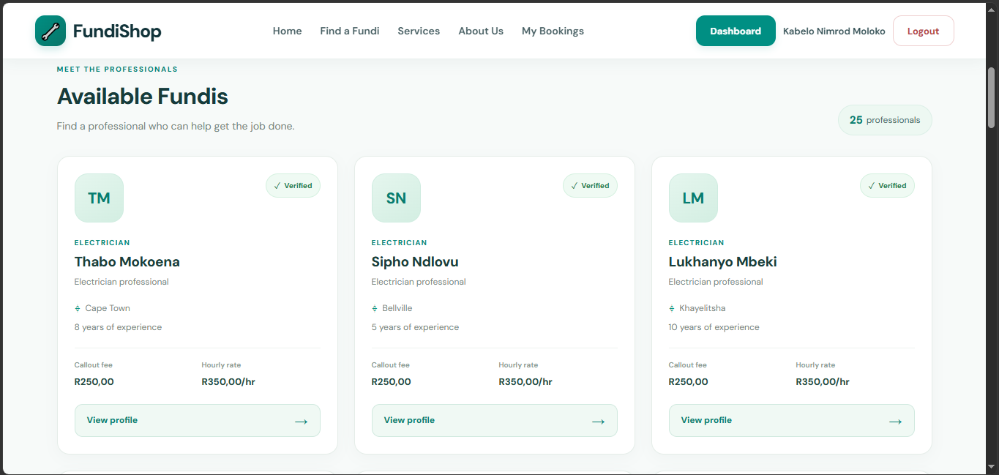

### US11 – Add Products and Building Materials

**User story:** As a fundi, I want to add products or building materials so that customers can view what I offer.

**Tasks:**
- Create a product listing form.
- Capture product details and prices.
- Validate submitted information.
- Save listing information through the backend.
- Display available listings.

**Acceptance criteria:**
- Required product information is validated.
- Product details can be saved when the feature is connected.
- Saved listings can be retrieved for display.

### US12 – Edit and Remove Listings

**User story:** As a fundi, I want to edit or remove my listings so that I can keep my information up to date.

**Tasks:**
- Implement listing retrieval.
- Add an edit function.
- Add a delete function.
- Apply appropriate access restrictions.
- Test changes and removal.

**Acceptance criteria:**
- Authorised users can update their listings.
- Authorised users can remove their listings.
- Changes are reflected in the stored data.

### US13 – View Product Details

**User story:** As a homeowner, I want to view product details so that I can understand what is being offered before making a decision.

**Tasks:**
- Create a product details page or component.
- Display available descriptions and prices.
- Retrieve listing information from the backend.
- Test the display of available product information.

**Acceptance criteria:**
- Relevant product details are displayed.
- The correct listing information is shown.
- Missing or unavailable information is handled appropriately.

### US14 – Set Labour and Callout Rates

**User story:** As a fundi, I want to provide my labour and callout rates so that customers can understand the costs associated with my services.

**Tasks:**
- Define the required rate fields.
- Provide a form for entering rates.
- Validate the rate values.
- Save and retrieve the information.
- Display rates where applicable.

**Acceptance criteria:**
- Rate information is validated.
- Saved rates can be retrieved when the feature is implemented.
- Customers can view the available pricing information.

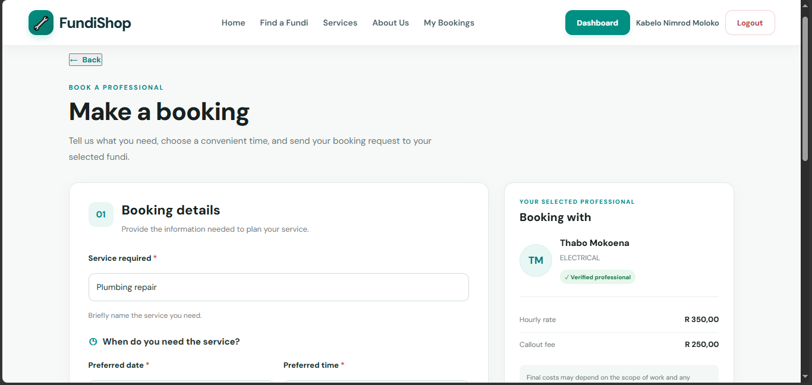

### US15 – Display Combined Job Pricing

**User story:** As a homeowner, I want to view the available job pricing information so that I can better understand the potential cost of a service.

**Tasks:**
- Identify the pricing information required.
- Define how labour and callout rates should be presented.
- Display the available pricing information.
- Test the displayed values.

**Acceptance criteria:**
- Available pricing information is presented clearly.
- The displayed amounts correspond to the relevant service or fundi.
- Any estimate is clearly distinguished from a confirmed final price.

### US16 – Search for Verified Fundis

**User story:** As a homeowner, I want to search for fundis so that I can find service providers who match my needs.

**Tasks:**
- Create the search interface.
- Retrieve relevant fundi information.
- Provide filtering or search criteria where supported.
- Display matching results.
- Test search results and empty searches.

**Acceptance criteria:**
- Users can search using the supported criteria.
- Matching fundis are displayed.
- Empty results are handled appropriately.
- Verification information is displayed accurately where available.
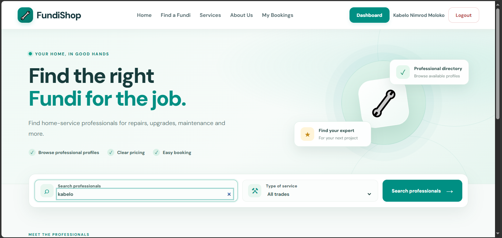

### US17 – Submit a Service Booking Request

**User story:** As a homeowner, I want to submit a booking request so that I can request a service from a fundi.

**Acceptance criteria:**
- A homeowner can submit the required booking details.
- The request is stored if the booking functionality is implemented.
- The relevant status can be viewed by authorised users.

### US18 – Review a Fundi

**User story:** As a homeowner, I want to submit a review after receiving a service so that I can share feedback about my experience.

**Acceptance criteria:**
- A review can be submitted through the implemented interface.
- Review data is validated and stored.
- Reviews are associated with the relevant fundi.
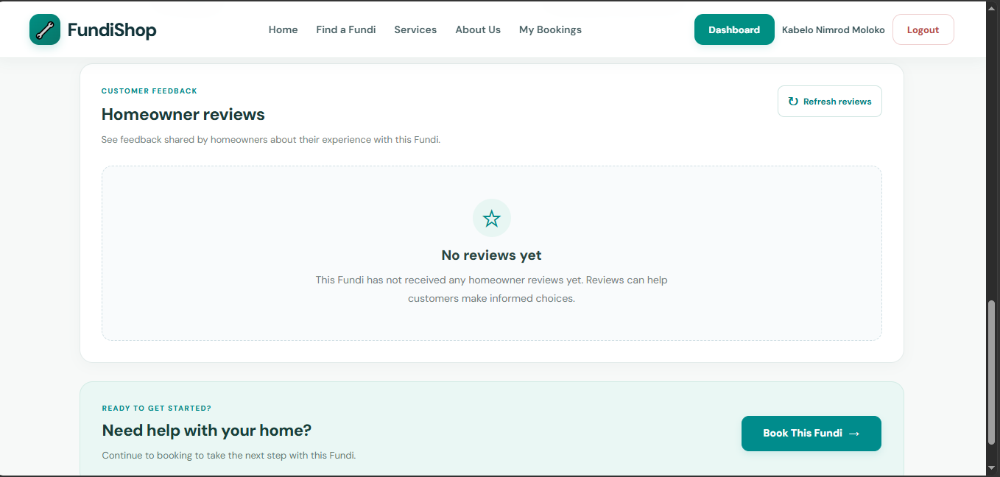

### US19 – Manage Booking Requests

**User story:** As a fundi, I want to view and manage booking requests so that I can respond to potential customers.

**Acceptance criteria:**
- Relevant booking requests can be viewed.
- A fundi can update a request's status where the feature is implemented.
- Changes are reflected in the stored information.

### US20 – Administer Platform Information

**User story:** As an administrator, I want to manage relevant platform information so that the application can be maintained appropriately.

**Acceptance criteria:**
- Administrative functions are restricted to authorised users.
- Supported management actions are recorded or reflected in the application.
- Invalid actions are handled appropriately.
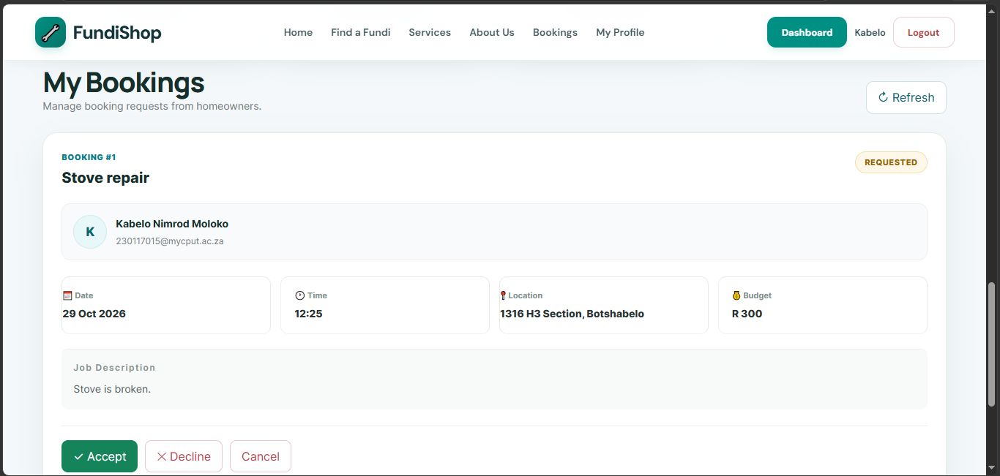

---

## 3. Product Backlog

The product backlog contains the features and improvements identified for the FundiShorp project. Items are organised according to their importance to the project's objectives.

The priorities below are proposed priorities for documentation purposes. The Trello board should be treated as the working source for the latest task status and sprint allocation.

| ID | Backlog item | Priority | Status |
|---|---|---|---|
| US01 | Establish database schema | High | Verify in Trello |
| US02 | Develop backend services | High | Verify in Trello |
| US03 | Develop React frontend | High | Verify in Trello |
| US04 | Prepare for deployment | Medium | Verify in Trello |
| US05 | Homeowner registration and login | High | Verify in Trello |
| US06 | Fundi registration | High | Verify in Trello |
| US07 | Role-based access | High | Verify in Trello |
| US08 | Fundi verification review | Medium | Verify in Trello |
| US09 | Verified fundi badge | Medium | Verify in Trello |
| US10 | Create a storefront | High | Verify in Trello |
| US11 | Add product and material listings | High | Verify in Trello |
| US12 | Edit and remove listings | Medium | Verify in Trello |
| US13 | View product details | Medium | Verify in Trello |
| US14 | Set labour and callout rates | Medium | Verify in Trello |
| US15 | Display job pricing | Medium | Verify in Trello |
| US16 | Search for verified fundis | High | Verify in Trello |
| US17 | Submit booking requests | Future | Proposed |
| US18 | Submit reviews | Future | Proposed |
| US19 | Manage booking requests | Future | Proposed |
| US20 | Administer platform information | Future | Proposed |

The backlog can be updated as requirements change, new issues are identified or tasks are completed. The priority and status of each item should be reviewed against the current Trello board.

**Trello project board:** [View the FundiShorp board](https://trello.com/b/aviqvFPS/fundishorp)

---

## 4. Sprint Backlog

The sprint backlog contains the items selected for work during a sprint, together with the tasks required to achieve the sprint goal.

For this project, Trello is used to organise work into backlog and sprint lists. The actual sprint allocation, task owners and completion status should be checked against the board.

### 4.1 Sprint Planning

During sprint planning, the selected user stories should be reviewed and divided into smaller tasks. The tasks should be realistic for the available time and should contribute towards a clear sprint goal.

Examples of development tasks include:

- Creating or updating database tables.
- Developing backend API endpoints.
- Building React components.
- Connecting the frontend to the backend.
- Testing API requests and database operations.
- Correcting identified errors.
- Updating project documentation.

### 4.2 Sprint Task Tracking

The following table is a template for recording sprint work. It should be updated using the actual information from Trello.

| User story or task | Expected outcome | Status |
|---|---|---|
| Database development | Required database structure | Confirm in Trello |
| Backend development | Required API functionality | Confirm in Trello |
| Frontend development | Required user interface | Confirm in Trello |
| Integration | Frontend and backend communication | Confirm in Trello |
| Testing | Evidence of testing and corrections | Confirm in Trello |
| Documentation | Updated project records | Confirm in Trello |

### 4.3 Sprint Review

A sprint review should be used to assess the work completed during the sprint. The review should identify which requirements have been demonstrated, which tasks remain incomplete and what should be prioritised next.

### 4.4 Sprint Retrospective

A retrospective should consider what went well, what challenges occurred and what improvements can be made during the next sprint.

Possible areas to review include:

- Task estimation and time management.
- Database and API integration.
- Testing and debugging.
- Communication and task tracking.
- Updating documentation as the project develops.

### 4.5 Trello Evidence

The Trello board provides supporting evidence of the project's backlog and sprint organisation.

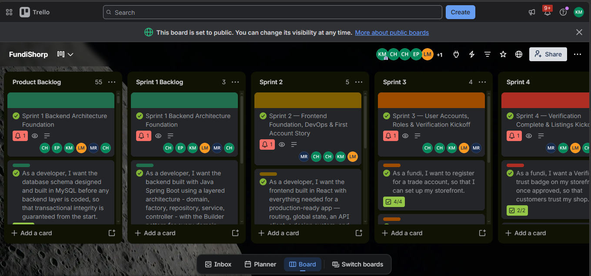

---

## 5. Agile Logbook

The Agile logbook is intended to record project activities, progress, challenges and lessons learned. Entries should reflect the actual work performed during the project.

### 5.1 Work Session Record

Use the following structure to document each work session or sprint activity.

| Date | Activity | Outcome | Challenges or next steps |
|---|---|---|---|
| Add actual date | Describe the work performed | Record the result | Record issues or follow-up tasks |

Additional entries should be added as the project progresses.

### 5.2 Sprint Reflection

At the end of each sprint, the following questions can be used to reflect on progress:

1. Which tasks were completed?
2. Which tasks remain incomplete, and why?
3. What problems were encountered?
4. What was learned during development?
5. What changes should be made in the next sprint?

### 5.3 Lessons Learned

The following areas are important to reflect on during development:

- **Database design:** Relationships and constraints should be planned carefully before integrating application features.
- **API integration:** Frontend requests should match the backend endpoints, request formats and response structures.
- **Testing:** Features should be tested after implementation, including unsuccessful and invalid requests.
- **Task management:** Large tasks should be broken into smaller activities that are easier to track.
- **Documentation:** Project evidence and progress records should be updated as work is completed.

These are areas for reflection, not a claim that every issue has already been resolved. Specific lessons should be recorded based on actual project experience.

---

## 6. Supporting Evidence and References

This section provides links and screenshots that support the project documentation.

### 6.1 Project Links

- [FundiShorp GitHub Repository](https://github.com/KabeloMoloko/FundiShorp-Portfolio)
- [FundiShorp GitHub Pages Portfolio](https://kabelomoloko.github.io/FundiShorp-Portfolio/)
- [FundiShorp Trello Board](https://trello.com/b/aviqvFPS/fundishorp)

### 6.2 Screenshot Evidence

The following screenshots are stored in the repository's `screenshots` folder:

| Screenshot | Evidence provided |
|---|---|
| `databaseschema.png` | Database schema |
| `backend.png` | Backend development |
| `frontend.png` | Frontend development |
| `register.png` | User registration interface |
| `fundireg.png` | Fundi registration interface |
| `role.png` | User roles |
| `fundis.png` | Fundi interface |
| `booking.png` | Booking or pricing-related interface |
| `trello.png` | Agile project board |

These screenshots are included to demonstrate selected aspects of the project. The implementation and testing status of each feature should be confirmed separately.

### 6.3 References

- Scrum Guides. *The Scrum Guide.* https://scrumguides.org/
- GitHub Docs. *About READMEs.* https://docs.github.com/en/repositories/managing-your-repositorys-settings-and-features/customizing-your-repository/about-readmes
- GitHub Docs. *GitHub Pages.* https://docs.github.com/en/pages

---

## Conclusion

Working on FundiShorp has allowed me to apply Agile project management concepts while developing a web application. The project combines requirements planning, user stories, backlog management, frontend development, backend development and database design.

This portfolio brings the main project documentation and selected development evidence together in one place. As development continues, I will update the backlog, record progress in the Agile logbook, test implemented features and revise the documentation to reflect the actual state of the application.

